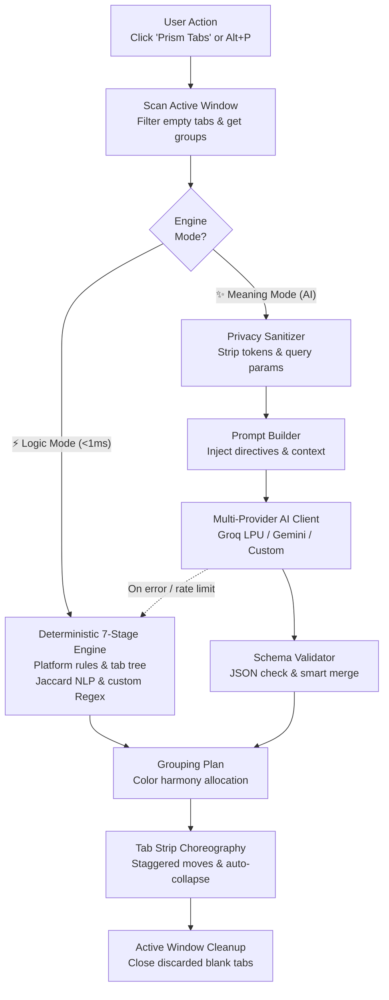

# 🌈 Prism — Dual-Engine Tab Organizer for Chrome

[](./LICENSE)
[](./public/manifest.json)
[](./tsconfig.json)
[](./tests)
[](#3-configuring-ai-providers-optional--meaning-mode)

**Prism** is a fast, privacy-first, open-source Google Chrome extension that eliminates tab overload through a **Dual-Engine Grouping Architecture**:

1. **⚡ Logic Mode (7-Stage Deterministic Engine)**: Instant `<1ms` offline tab grouping powered by 60+ curated platform & service profiles, GitHub/GitLab repository extraction, parent-child tab tree inheritance (`openerTabId`), Jira/Linear ticket ID extraction, Jaccard NLP title similarity, temporal/positional context chains, and customizable Regex rules. Zero latency, zero token cost.
2. **✨ Meaning Mode (Multi-Provider BYOK Semantic AI)**: Context-aware semantic clustering powered by **Groq LPU** (with automatic multi-model TPM rotation), **Google Gemini 2.5 Flash**, or any **Custom OpenAI-Compatible** endpoint. Understands cross-domain workflows, respects your existing groups, supports custom user sorting directives, and assigns expressive emojis and harmonious Chrome Tab Group colors.

---

## ✨ Key Features

- **One-Click Instant Execution (`Alt+P`)**: Click **Prism Tabs** (or press `Alt+P`) to immediately analyze and organize tabs in your active Chrome window with smooth, staggered tab-strip choreography.
- **Non-Destructive Smart Merging**: Respects your existing Chrome Tab Groups (`Preserve existing groups`). New ungrouped tabs that match an existing group by domain, rule, or semantic topic are merged into that group instead of creating duplicates.
- **Automatic Empty Tab Cleanup**: Automatically closes leftover blank `New Tab` / `about:blank` pages in the active window during sorting (toggleable in `⚙️ Settings`).
- **Auto-Collapse Inactive Groups**: Keeps your tab bar clean by automatically collapsing all groups except the one containing your currently active tab.
- **Active Window Isolation**: All tab queries, group merges, and undo snapshots operate strictly within your current active browser window (`currentWindow: true`), leaving other open Chrome windows untouched.
- **Live Inline Group Editing**: Rename any group, change its native Chrome color dot, or ungroup individual clusters directly from the popup list.
- **Full 1-Click Undo (`Ctrl+Z`) & Ungroup All (`Alt+U`)**: Captures a complete window snapshot (`UndoSnapshot`) before every sort so you can restore your exact previous tab order and groups in one click.

---

## 🏗️ Architecture & Dual-Engine Flow



### Project Directory Structure

```text
prism-tabs/
├── public/
│   ├── manifest.json               # Chrome Manifest V3 configuration (minimal permissions)
│   └── icons/                      # Extension icons (16, 32, 48, 128px + SVG)
├── src/
│   ├── background/
│   │   └── index.ts                # Non-persistent MV3 service worker (Alt+P / Alt+U hotkeys)
│   ├── engine/
│   │   ├── types.ts                # Core data models & ChromeTabGroupColor types
│   │   ├── deterministic.ts        # 7-Stage Logic Mode: platforms, openerTabId, NLP & color harmony
│   │   └── semantic.ts             # Meaning Mode: sanitizer, prompt builder & schema validator
│   ├── services/
│   │   ├── geminiService.ts        # Multi-provider AI client (Groq multi-model rotation, Gemini, Custom)
│   │   └── chromeTabsService.ts    # Active-window chrome.tabs / chrome.tabGroups & Undo manager
│   ├── storage/
│   │   └── storageService.ts       # Typed chrome.storage.local persistence layer
│   ├── ui/
│   │   ├── App.tsx                 # Main One-Click Popup UI & unified settings sheet
│   │   ├── colorPalette.ts         # Native Chrome Tab Group color tokens
│   │   ├── styles.css              # Tailwind CSS + Prism spectral keyframe animations
│   │   └── components/
│   │       ├── PrismRefractionBar.tsx
│   │       ├── GroupPreviewModal.tsx
│   │       ├── RulesDrawer.tsx
│   │       └── SemanticSettingsDrawer.tsx
└── tests/
    ├── deterministic.test.ts       # Unit tests for 7-stage deterministic engine & smart merging
    └── semantic.test.ts            # Unit tests for privacy sanitization, Groq/Gemini & fallback
```

---

## 🚀 Quickstart & Installation

### Prerequisites
- **Node.js** `>= 18.x` and **npm**
- **Google Chrome** (or any Chromium browser supporting Manifest V3 and `chrome.tabGroups`)

### 1. Clone & Build

```bash
git clone https://github.com/vagram-karapetyan/prism-tabs.git
cd prism-tabs
npm install
npm run build
```

Running `npm run build` compiles TypeScript and bundles the production extension into the `dist/` directory.

### 2. Load Unpacked Extension in Chrome

1. Open Google Chrome and navigate to `chrome://extensions/`.
2. Enable **Developer mode** using the toggle in the top-right corner.
3. Click **Load unpacked** in the top-left corner.
4. Select the generated `dist/` folder inside your `prism-tabs` directory.
5. Pin **Prism** in your Chrome toolbar and click **Prism Tabs** (or press `Alt+P`)!

### 3. Configuring AI Providers (Optional — Meaning Mode)

1. Click the **`⚙️` Settings** gear in the top-right corner of the Prism popup.
2. Under **AI Setup**, select your preferred provider:
   - **Groq (Recommended)**: Paste your free key from [console.groq.com/keys](https://console.groq.com/keys) (`gsk_...`). Prism automatically rotates across multiple fast models (`Llama 3.3 70B`, `Qwen 3.8 27B`, `GPT OSS 120B/20B`, `Llama 3.1 8B`) if a single model hits free-tier per-minute token limits.
   - **Google Gemini**: Paste your key from [aistudio.google.com/app/apikey](https://aistudio.google.com/app/apikey).
   - **Custom OpenAI-Compatible**: Configure any custom base URL (`https://api.openai.com/v1`, OpenRouter, local Ollama/vLLM) and model ID.

*(For local development builds, you can also copy `.env.example` to `.env.local` and set `VITE_GROQ_API_KEY=gsk_...`.)*

### 4. Running Tests & Typecheck

```bash
# Run the Vitest unit test suite (59 tests)
npm test

# Run TypeScript strict type-checking
npm run typecheck

# Rebuild automatically on file changes
npm run dev
```

---

## 🔒 Privacy & Security Guarantees

- **Minimal Permissions**: Requests only `tabs`, `tabGroups`, and `storage`. Zero `<all_urls>` host permissions, zero content scripts injected into web pages, and zero browsing history access.
- **100% On-Device Logic Mode**: Deterministic grouping runs entirely inside your local browser process with zero network requests.
- **Sanitized Meaning Mode**: When Meaning Mode is used, Prism strips URL query strings, session tokens, hash fragments, and long hexadecimal UUIDs before sending tab titles and hostnames to your chosen AI endpoint. Cookies, page DOM bodies, and internal `chrome://` URLs are **never** accessed or transmitted.
- **Bring-Your-Own-Key (BYOK)**: Your API keys are stored exclusively in `chrome.storage.local` on your device.

---

## 🏷️ Topics & Tags

| Category | Topics / Tags |
| :--- | :--- |
| **Domain** | `chrome-extension` `tab-manager` `tab-groups` `tabs-organizer` `productivity` |
| **Intelligence** | `groq` `gemini` `byok` `ai` `llm` `semantic-clustering` |
| **Tech Stack** | `typescript` `vite` `tailwind-css` `manifest-v3` `react` |
| **Principles** | `privacy-first` `zero-telemetry` `local-first` `gpl-v3` `open-source` |

---

## 📄 License

Distributed under the **GNU General Public License v3.0 (GPL-3.0)**. See [`LICENSE`](./LICENSE) for full details.
