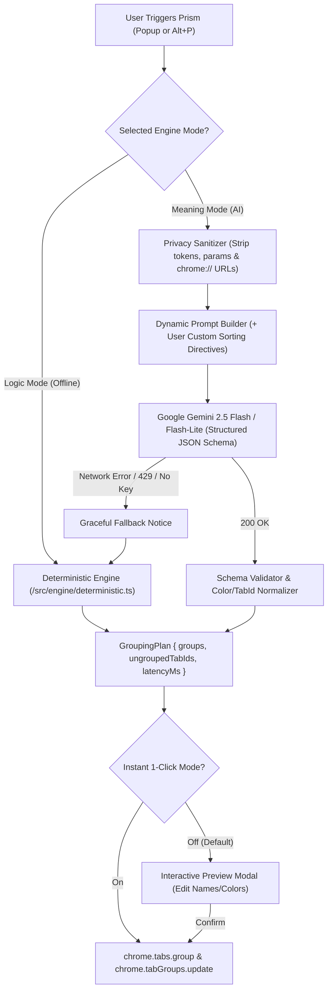

# 🌈 Prism — Dual-Engine Tab Organizer for Chrome

[](./LICENSE)
[](./public/manifest.json)
[](./tsconfig.json)

**Prism** is a fast, privacy-first, open-source Google Chrome extension that eliminates tab overload through a **Dual-Engine Grouping Architecture**:

1. **⚡ Logic Mode (Deterministic)**: Instant `<1ms` offline tab grouping powered by registrable domain extraction, multi-part TLD parsing, URL path rules, and customizable Regular Expression (Regex) matchers. Zero latency, zero token cost.
2. **✨ Meaning Mode (Semantic AI)**: Context-aware semantic clustering powered by **Google Gemini Flash / Flash-Lite** (Bring-Your-Own-Key). Understands cross-domain task intents (e.g., clustering a GitHub PR, a Linear issue, and a Vercel preview deployment for the same feature), supports **custom user sorting directives**, assigns concise group names with expressive emojis, and maps them to native Chrome Tab Group colors.

---

## 🎯 The Problem

Modern knowledge workers routinely juggle 25–80+ open browser tabs across heterogeneous domains.
- **Purely domain-based extensions** fail when a single workflow spans multiple tools (`github.com` + `linear.app` + `figma.com` + `localhost`).
- **Purely AI-based extensions** introduce network latency on every sort, fail when offline or rate-limited, and often lack deterministic rule overrides.

**Prism bridges both worlds**: instant local determinism when you want speed, and custom-steerable Gemini semantic intelligence when you want task-level organization—with automatic, seamless fallback to Logic Mode if you are offline or hit API rate limits.

---

## ✨ Visual Feature Overview

- **Signature "Prism Refraction" UI**: A dark glassmorphic interface featuring an animated beam of white light refracting through a crystalline prism into Chrome's 9 native spectral tab group colors (`grey`, `blue`, `red`, `yellow`, `green`, `pink`, `purple`, `cyan`, `orange`).
- **Custom User Prompting & AI Directives**: Steer Gemini Flash with your own sorting rules or 1-click presets:
  - *"Group by project urgency: separate active blockers from background reading"*
  - *"Cluster shopping tabs by gift recipient or product category"*
  - *"Strictly separate personal research from software engineering tickets & PRs"*
- **Interactive Preview & 1-Click Mode**: Inspect proposed clusters, inline-edit group titles, swap Chrome Tab Group colors, or remove individual clusters before applying—or toggle **1-Click Mode** for instant sorting.
- **Full Undo & Ungroup All**: Captures a complete window snapshot (`UndoSnapshot`) before every grouping operation so you can restore your exact prior tab order and groups with `Ctrl+Z` or one click.
- **Keyboard Shortcuts**:
  - `Alt+P` (`Command+Shift+P` on macOS): Run Prism Sort in the active window.
  - `Alt+U` (`Command+Shift+U` on macOS): Ungroup all tabs in the active window.

---

## 🏗️ Architecture & Dual-Engine Flow



### Project Directory Structure

```text
prism-tabs/
├── public/
│   ├── manifest.json               # Chrome Manifest V3 configuration (minimal permissions)
│   └── icons/prism.svg             # Vector Prism iconography
├── src/
│   ├── background/
│   │   └── index.ts                # Non-persistent MV3 service worker (hotkey handler)
│   ├── engine/
│   │   ├── types.ts                # Core data models & ChromeTabGroupColor types
│   │   ├── deterministic.ts        # Logic Mode: domain parser, regex matcher & priority engine
│   │   └── semantic.ts             # Meaning Mode: sanitizer, prompt injector & schema validator
│   ├── services/
│   │   ├── geminiService.ts        # BYOK Google Gemini Flash REST client (JSON schema mode)
│   │   └── chromeTabsService.ts    # Native chrome.tabs / chrome.tabGroups & Undo snapshot manager
│   ├── storage/
│   │   └── storageService.ts       # Typed chrome.storage.local persistence layer
│   └── ui/
│       ├── App.tsx                 # Main Popup surface & mode controller
│       ├── colorPalette.ts         # Native Chrome Tab Group color tokens
│       ├── styles.css              # Tailwind CSS + Prism spectral keyframe animations
│       └── components/
│           ├── PrismRefractionBar.tsx
│           ├── GroupPreviewModal.tsx
│           ├── RulesDrawer.tsx
│           └── SemanticSettingsDrawer.tsx
└── tests/
    ├── deterministic.test.ts       # Unit tests for domain extraction, regex rules & priorities
    └── semantic.test.ts            # Unit tests for privacy sanitization, prompt injection & fallback
```

---

## 🚀 Quickstart & Local Developer Installation

### Prerequisites
- **Node.js** `>= 18.x` and **npm**
- **Google Chrome** (or any Chromium-based browser supporting Manifest V3 and `chrome.tabGroups`)

### 1. Clone & Build

```bash
git clone https://github.com/your-username/prism-tabs.git
cd prism-tabs
npm install
npm run build
```

Running `npm run build` compiles TypeScript and bundles the extension into the `dist/` directory.

### 2. Load Unpacked Extension in Chrome

1. Open Google Chrome and navigate to `chrome://extensions/`.
2. Enable **Developer mode** using the toggle in the top-right corner.
3. Click **Load unpacked** in the top-left corner.
4. Select the generated `dist/` folder inside your `prism-tabs` directory.
5. Pin **Prism** from the Chrome Extensions puzzle menu in your toolbar and click it (or press `Alt+P`)!

### 3. Running Tests & Development Watcher

```bash
# Run the Vitest unit test suite
npm test

# Run TypeScript strict type-checking
npm run typecheck

# Rebuild automatically on file changes
npm run dev
```

---

## 🔒 Privacy & Security Disclaimer

Prism is designed from the ground up with strict privacy guarantees:
- **Minimal Permissions**: Requests only `tabs`, `tabGroups`, and `storage`. No `<all_urls>` host permissions, no content script injection into your web pages, and no browsing history access.
- **100% On-Device Logic Mode**: Deterministic grouping runs entirely inside your local browser process with zero network requests.
- **Sanitized Meaning Mode**: When Meaning Mode is used, Prism strips URL query strings, session tokens, hash fragments, and long hexadecimal UUIDs before sending tab titles and hostnames to the Google Gemini API. Cookies, page DOM bodies, and internal `chrome://` URLs are **never** accessed or transmitted.
- **Bring-Your-Own-Key (BYOK)**: Your Gemini API key is stored exclusively in `chrome.storage.local` on your device and is transmitted only via the `x-goog-api-key` header directly to `generativelanguage.googleapis.com`.

---

## 🤝 Contributing

Contributions, issues, and feature requests are welcome!
1. Fork the repository and create your feature branch (`git checkout -b feat/amazing-feature`).
2. Add unit tests in `tests/` covering any new engine logic.
3. Ensure `npm run typecheck`, `npm test`, and `npm run build` pass cleanly.
4. Open a Pull Request.

---

## 📄 License

Distributed under the **MIT License**. See [`LICENSE`](./LICENSE) for full details.
